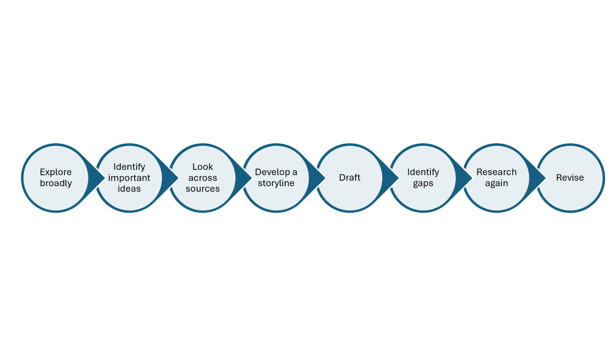
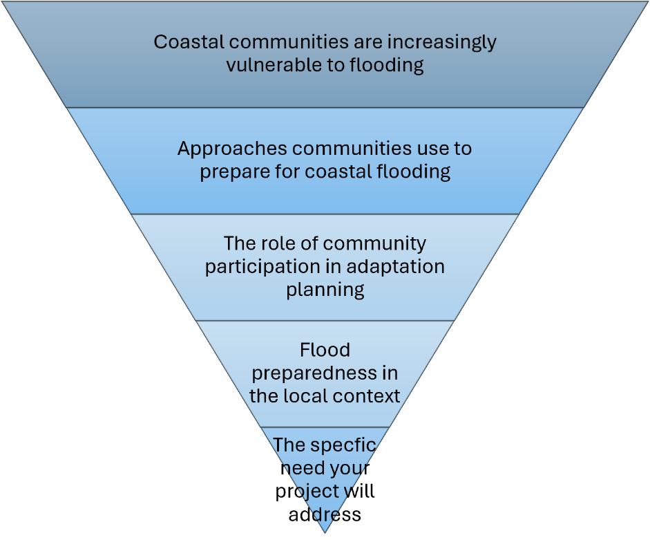
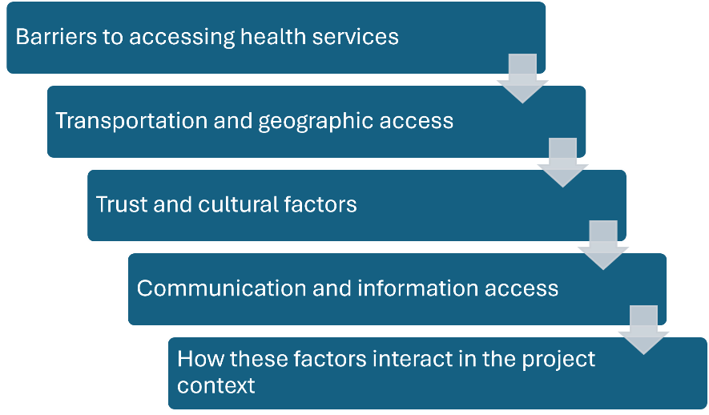
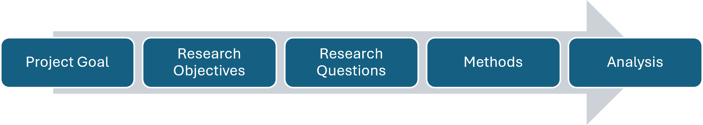

[Contents](index.html)

# Chapter 2 - Building Your Research Story

**On this page**

- [2.1 Introduction](#introduction)
- [2.2 Background Chapter](#background-chapter)
- [2.3 Methods Chapter](#methods-chapter)

Your ID 2050 research proposal has three main chapters: **Introduction, Background, and Methods**. Together, these chapters tell the story of your project and your plan for how you will conduct your research. During your IQP, you will revise these chapters as your project develops to add additional background context, document your actual research process, and ensure your final report accurately represents the project you completed.

## 2.1 Introduction

### What is the purpose of the introduction?

The Introduction gives readers their first understanding of your project. It should help them understand the larger societal context, the specific problem or opportunity your project addresses, why the project is needed, and what your team will do about it.

For most projects, this can be accomplished in about five paragraphs, although some projects will need more. Rather than focusing on the number of paragraphs, think about the five moves your Introduction needs to make.

**Move 1: Establish the Broader Context**

Begin with the larger societal context connected to your project. What is happening in the world, country, region, field, or community that makes this project important? Use research or evidence where appropriate to help readers understand the significance of the issue.

**Move 2: Identify the Local Problem or Opportunity**

Narrow the focus to the specific problem, need, or opportunity your project addresses. What does the larger issue look like in your local context? Who is affected? This is often where you will briefly introduce your project host and their connection to the issue.

**Move 3: Explain What Is Already Known or Being Done**

Briefly establish what is already known about the problem and what has already been done to address it. This might include previous research, programs, policies, practices, or approaches. You will develop these ideas more fully in your Background. Here, include what your reader needs to understand the current situation.

**Move 4: Identify What Still Needs to Be Understood or Addressed**

Given what is already known or being done, what is still missing, unresolved, or not working well enough? For an IQP, this does not have to be a gap in academic research. It may be a practical gap in knowledge, understanding, practice, or capacity. This is what creates the need for your project.

**Move 5: Introduce Your Project and Its Purpose**

Finally, explain how your project responds to that need. Introduce your project goal and the major objectives that will guide your work. You do not need to explain the details of your research methods here. Your reader simply needs to understand what your team is trying to accomplish and how it connects to the problem you have established.

Together, the five moves should create a logical progression. You will end the Introduction with a brief roadmap that helps readers understand where the report will go next.

### Writing Your Proposal Introduction

Your proposal Introduction represents your team's best understanding of the project during ID2050. You may understand some parts of the project before others, so expect to return to the Introduction as you conduct more background research, talk with your project host, and refine your project goal and objectives. By the end of the Introduction, your reader should understand why the project is needed and what your team plans to accomplish.

### Writing Your Final Report Introduction

When you return to the Introduction during IQP, do not simply change the verbs from future to past tense. Return to the five moves and ask whether they still tell the right story. Your understanding of the context, problem, stakeholders, or project itself may have changed. Revise the Introduction to reflect what you understand now and the project you completed.

Pay particular attention to Moves 4 and 5. Does the need you identified in the proposal still make sense based on what you learned? Does your project goal accurately represent the work you ultimately completed? Update the roadmap as well so that it reflects the organization of your final report.

### Planning Your Next Steps

Use the five moves to sketch the structure of your Introduction before you begin drafting. You do not need complete sentences. Jot down the main ideas, evidence you might use, and anything your team still needs to figure out.

| **Introduction Move and Questions to Guide Your Planning** | **Your Ideas** |
|----|----|
| **1. Broader Context:** What larger societal context does our reader need to understand? Why does it matter? What evidence or information might help establish its importance? |  |
| **2. Local Problem or Opportunity:** What is the specific problem, need, or opportunity our project addresses? What does our reader need to know about the local context and our project host's connection to the issue? |  |
| **3. What Is Already Known or Being Done:** What does our reader need to know about what has already been learned, tried, or done? What research, programs, policies, practices, or other approaches are most relevant? |  |
| **4. What Still Needs to Be Understood or Addressed:** What is still missing, unresolved, unknown, or not working well enough? What does our project host or community still need to know, understand, develop, evaluate, or address? |  |
| **5. Our Project:** How does our project respond to the need we identified? What are we trying to accomplish? What is our project goal? What are our major objectives? |  |
| **Look at the Introduction as a Whole:** Can we trace a clear path from the larger issue to the need for our project? Where does the story make a jump? What do we still need to research, discuss, or figure out? |  |

<a href="assets/worksheets/Worksheet_Planning%20your%20introduction.docx" download>Download worksheet: Planning your Introduction (Word .docx)</a>

## 2.2 Background Chapter

### What is the purpose of the Background Chapter?

The Background Chapter provides the research and context needed to understand your project. Depending on the project, this may include research about the larger issue, the local context, important stakeholders and their perspectives, previous efforts to address the problem, and approaches used in other places or contexts.

You may also hear this chapter referred to as a literature review. In this guide, I use the term *Background*, but you can think of *Background* and *literature review* as referring to the same general part of your research report. In both cases, the goal is to bring together and synthesize existing research and knowledge related to your project.

The purpose of the Background can change as you move from your ID2050 proposal to your final report. During ID2050, the process of researching the Background is an important part of how your team prepares for the project. You will likely begin with limited knowledge about the topic, local context, stakeholders, or approaches others have used to address similar problems. Background research helps your team come up to speed on the project and develop the knowledge you need to make informed decisions about your research. You then use what you have learned to write a formal Background chapter.

By the time you write your final report, you have developed a much deeper understanding of the project and the purpose of the Background shifts toward your reader. In your final report, your Background will provide readers with the context they need to understand your project, research, findings, and recommendations. This is why you will revisit and revise your Background during your IQP term.

**Purpose of the Background Chapter**

| **ID2050 Proposal** | **IQP Final Report** |
|----|----|
| Help your team come up to speed on the topic and develop the knowledge needed to plan and conduct your research. | Help your reader understand the context and existing knowledge needed to make sense of the project and the research you completed. |

### Researching for your Background Chapter

Developing your Background is an iterative process. You will not know everything you need to research at the beginning, and you do not need to finish your research before you start writing. What you learn will lead to new questions, and writing will often help you identify gaps in your understanding.

**The Research and Writing Process**

As you work through this process, look for patterns, different perspectives, areas of agreement and disagreement, previous approaches, and questions that remain unresolved. The goal is to move from collecting information to making sense of what you are learning. You will probably move back and forth among these steps rather than following them once in order. That is part of the research and writing process.

### Synthesizing Your Research

A strong Background is organized around ideas rather than individual sources. Your sources provide evidence for the ideas you are developing, but the sources themselves should not determine the organization of the chapter. As you write, look across your research. *Where do sources agree or disagree? What patterns emerge? What different perspectives are represented? What does the research collectively help you understand about the issue?*

Instead of writing a paragraph about one source followed by a paragraph about another, bring information from multiple sources together to develop the ideas your reader needs to understand.

The goal is to move from reporting what individual sources say to synthesizing what the research helps us understand about the issue.

### Organizing Your Background

There is no single correct way to organize a Background chapter. Choosing the structure is one of the important decisions your team will make. Think about the story your Background needs to tell. *What does your reader need to understand first? What information builds on that understanding? How should the chapter eventually lead toward the research your team will conduct?*

The following structures are useful starting points, but they are not required formats.

#### The Funnel

A funnel moves from the broader issue toward the specific context of your project. A funnel works well when your reader first needs to understand a larger issue before they can understand the specific local problem. The important question is not simply whether you can move from broad to narrow.

Ask:

*Does understanding each section help the reader understand why the next section matters?*

#### The Sandwich

Sometimes readers need to understand the local context before the broader research will make sense. In this case, a sandwich structure may work better.

The community and its current waste-management challenge\
↓\
Research on household waste behaviors\
↓\
Approaches used in other communities\
↓\
What is known about participation and behavior change\
↓\
What this research suggests for the local project

Here, you begin with the specific local context, step back to consider broader research and examples, and then return to the project context with a stronger understanding of it. A sandwich structure can be useful when the project is strongly grounded in a particular place, organization, or community and readers need that context to understand why the broader research is relevant.

#### A Thematic Structure

For some projects, there is no obvious broad-to-narrow sequence. Instead, readers may need to understand several connected dimensions of a problem.

A thematic structure can work well when several related issues or perspectives need to be understood together.

#### Other Organization Options

Funnel, sandwich, and thematic are potential structures and not firm rules for how to organize your background chapter. Your project may need a variation, a combination of these approaches, or a different structure entirely. Whatever approach you choose, your team should be able to explain the logic behind the flow, and you should ensure that your writing includes transitions that help the reader understand the connection as you move from one section to the next.

You can use descriptive section headings to help make that structure visible. Your headings should tell readers something about the ideas in the section rather than simply label broad categories such as *Previous Research* or *Project Host*. The Background should ultimately bring your reader to the point where your own research follows logically from what is already known and what still needs to be understood.

### Related Guidance

Several other parts of this guide address research and writing skills that you will use when developing your Background. You can refer to these sections as needed when you are writing your background chapter.

- Quoting, Paraphrasing, and Summarizing: Section 5.4

- Citations and References: Section 5.4

- Using AI in Research and Writing: Section 5.4

### Writing Your Proposal Background

The background chapter in your proposal represents what your team understands before beginning your IQP. The process of conducting background research should help you come up to speed on the major issues surrounding your project and make informed decisions about the research you plan to conduct. By the end of ID2050, your Background should formally synthesize what your team has learned and provide a strong foundation for your proposed research.

### Writing Your Final Report Background

Your proposal Background gives you a strong starting point for the final report, but it will need to be revisited and revised before you can include it in your final report. The purpose of your background in your final report is to provide your reader with enough context to understand the project you completed. To revise your background chapter, you may need to:

- Keep material your readers still need to understand the project.

- Add research or context you learned during IQP.

- Remove information your team needed to learn in ID2050 but your reader does not need.

- Revise explanations you now understand differently.

- Reorganize the chapter if the original structure no longer fits the completed project.

Your final Background Chapter should represent what your team understands about the project now, not simply what you knew when you wrote the proposal. As you revise, also pay attention to the difference between Background and Findings. Both may contain information that helps readers understand your project, but the key difference is often where the knowledge came from. The background draws primarily on knowledge that already existed, while findings present knowledge your team generated through your research.

|  | **Background** | **Findings** |
|----|----|----|
| **Where does the knowledge come from?** | Existing research, reports, documents, and other knowledge produced by others | Evidence your team collected and analyzed through your project research |
| **Why is it included?** | To give readers the context and existing knowledge they need to understand the project | To show what your research helped you learn and how it answers your research questions |

### Planning Your Next Steps

Before you begin drafting your Background, your team needs to decide how you will organize the chapter. Take a step back from the individual sources and topics you have been researching and think about the story your Background needs to tell. Use these questions to plan the organization of your chapter:

1.  What are the major ideas your reader needs to understand?

2.  How are those ideas connected?

3.  What does your reader need to understand first for the later sections to make sense?

4.  Which ideas belong together in the same section?

5.  Would a funnel, sandwich, thematic, or another structure work best for your project?

6.  Where should the Background leave the reader so that your own research follows logically?

Then sketch a possible outline for your chapter. Focus first on the ideas and the order in which your reader needs to encounter them. Don't worry about perfect section headings yet. Your outline can continue to change as your team's understanding develops.

| Background Section | What is the purpose of this section? | Why does this section appear in this order? |
|----|----|----|
| Beginning: |  |  |
| Next: |  |  |
| Next: |  |  |
| Next: |  |  |
| Leading to our research: |  |  |

<a href="assets/worksheets/Worksheet_Planning%20your%20background%20chapter.docx" download>Download worksheet: Planning your Background Chapter (Word .docx)</a>

## 2.3 Methods Chapter

### What is the purpose of the Methods Chapter?

The Methods Chapter explains how your team will conduct, or conducted, the research needed to accomplish your project goal. It connects what you are trying to accomplish with what you need to learn and the methods you will use to learn it. Think of your Methods Chapter as an instruction manual for your research. In your ID2050 proposal, it provides the plan your team will use to guide your research during IQP. In your final report, it documents what you actually did in enough detail that another researcher could understand and repeat your approach.

A strong Methods Chapter explains three things throughout:

***WHAT you want to learn.***

***HOW you will learn it.***

***WHY this approach makes sense.***

In your proposal, the Methods Chapter is your research plan. In your final report, it records the research you actually conducted.

|  | **ID2050 Proposal** | **IQP Final Report** |
|----|----|----|
| Purpose of the Methods Chapter | Provide a detailed research plan that will guide your team's work during IQP. | Document what your team actually did and how you did it so readers can understand, evaluate, and potentially repeat your research. |

### Developing Your Research Design

A strong Methods Chapter begins before you select your methods. It
can be tempting to begin by saying, "we will conduct interviews" or "we
will create a survey." But selecting a method should not be the first
step. First decide <u>what you are trying to accomplish</u> and <u>what
you need to learn</u>. Then decide the methods you will use to learn
it.

Your research design should create a logical connection between your:

Each part should help you make decisions about the next.

### Project Goal

Your project goal describes what your team ultimately hopes to
accomplish through the project. It should respond to the problem or
opportunity you established in your Introduction and Background. Your
goal tells us where the project is going. It should be broad enough to
capture the overall purpose of your project but specific enough that
your team can realistically accomplish it during your IQP. A goal might
generally take this form: <strong>To <u><em>[accomplish
something]</em></u> for/with <em><u>[project host or community]</u></em>
in order to <em><u>[larger purpose]. </u></em></strong>The exact wording
will depend on your project.

### Research Objectives

Your research objectives identify the major areas your team needs to investigate or understand in order to accomplish your project goal. Objectives should focus on what you need to learn, understand, assess, evaluate, explore, or determine, rather than simply listing the activities you plan to complete.

For example:

Objective: ***Understand residents' current transportation behaviors and barriers to using public transit.*** (This is something you need to learn in order to accomplish your goal.)

is different from: <em>Conduct interviews with residents.</em>
(Conducting interviews is a <u>method</u> your team might use to
accomplish the objective.)

It is also different from: <em>Develop a transportation
guide.</em>(This might be a <u>deliverable</u> produced as a result of
the project.)

Keeping these distinctions clear will help you develop a research plan in which every activity has a purpose.

### Research Questions

Research questions make your objectives more specific. They identify the questions your team needs to answer in order to accomplish each objective.

For example:

Objective: ***Understand residents' current transportation behaviors and barriers to using public transit.***

Possible research questions might include:

- *How do residents currently travel?*

- *What barriers prevent residents from using public transit?*

- *Do those barriers differ among stakeholder groups?*

Research questions should be specific enough that you can begin asking: *What information would allow us to answer this question?* That question provides the bridge between your research questions and your methods.

#### Start Planning Your Research Goal, Objectives, and Research Questions

Before deciding which methods to use, take some time with your team to complete the table below, working from your project goal toward the information you need and where or from whom you might obtain that information.

<table>
<colgroup>
<col style="width: 12%" />
<col style="width: 18%" />
<col style="width: 19%" />
<col style="width: 26%" />
<col style="width: 22%" />
</colgroup>
<thead>
<tr>
<th>Project Goal</th>
<th>Research Objective</th>
<th>Research Questions</th>
<th>What information do we need?</th>
<th>Who or what can provide it?</th>
</tr>
</thead>
<tbody>
<tr>
<td rowspan="5"></td>
<td>1.</td>
<td></td>
<td></td>
<td></td>
</tr>
<tr>
<td>2.</td>
<td></td>
<td></td>
<td></td>
</tr>
<tr>
<td>3.</td>
<td></td>
<td></td>
<td></td>
</tr>
<tr>
<td></td>
<td></td>
<td></td>
<td></td>
</tr>
<tr>
<td></td>
<td></td>
<td></td>
<td></td>
</tr>
</tbody>
</table>

<a href="assets/worksheets/WORKSHEET%20%E2%80%93%20Planning%20Your%20Goal%2C%20Objectives%2C%20and%20Research%20Questions.docx" download>Download worksheet: Planning Your Goal, Objectives, and Research Questions (Word .docx)</a>

Look across your plan before moving on to methods.

- *Does each objective help you accomplish your project goal?*

- *Do your research questions help you accomplish the objective?*

- *Do you know what information you would need to answer each question?*

- *Are any of your objectives actually methods, activities, or deliverables?*

Once you know what you need to learn and what information you need, you are ready to decide what methods you will use to collect it.

### Choosing Your Methods

A research method is the approach you use to collect the information needed to answer your research questions. Depending on your project, your methods might include interviews, surveys, focus groups, observation, archival research, comparative analysis, or other approaches appropriate to your research questions. Your project should use multiple methods. Different methods can help you answer different questions, gather information from different sources, or provide different perspectives on the same issue.

Selecting a method is only the beginning. Your Methods Chapter needs to explain what you will do, how you will do it, and why that approach makes sense.

**WHAT will you do?**

Explain the method and what you hope to learn from it. Be specific about the information you are trying to collect and its relationship to your research question or objective.

**HOW will you do it?**

Explain how you will actually implement the method. Depending on the method, this may include:

- who will participate in the research;

- how participants, locations, documents, or other sources will be selected;

- how participants will be recruited;

- where or how the research will take place;

- what questions, protocols, instruments, or measurements you will use;

- how much information you intend to collect;

- how you will record, organize, and manage the information; and

- how you will analyze the information once it is collected.

The details will be different for different methods. Interviews will require different information than observations, surveys, or archival research.

**WHY is this the right approach?**

Do not assume that the reason for choosing a particular method will be obvious to your reader. Explain why the method is appropriate for the information you need and the context in which you will be working. Consider:

- Why will this method help answer your research question?

- Why are these participants, locations, documents, or other sources appropriate?

- Why are you collecting the information you propose?

- Have other researchers successfully used a similar approach? When useful, cite methodological guidance or previous studies to support your research choices.

- Are there characteristics of the local context or population that influenced your decision?

- What are the strengths and limitations of the method?

Your justification should show that the method is an intentional research decision rather than simply a convenient activity.

### Connect Research Questions to Methods

Use your research questions to work through the major decisions for each method before you begin writing the chapter.

| Research Question | Information Needed | Source of Information | Method | How will we collect it? | Why does this method make sense? |
|----|----|----|----|----|----|
|  |  |  |  |  |  |
|  |  |  |  |  |  |
|  |  |  |  |  |  |
|  |  |  |  |  |  |
|  |  |  |  |  |  |

<a href="assets/worksheets/WORKSHEET%20%E2%80%93%20Connect%20Research%20Questions%20to%20Methods.docx" download>Download worksheet: Connect Research Questions to Methods (Word .docx)</a>

A method may help answer more than one research question, and you may use more than one method to answer the same question. What matters is that you can explain the connection between what you need to learn and how you plan to learn it.

### Planning for Data Analysis

Your research design should include a plan for how you will make sense of the information you collect. Collecting data is only the beginning, you also need to analyze that data to answer your research questions.

During ID2050, you may not yet know exactly how you will analyze your data. That is okay. Qualitative data analysis is an iterative process, and your approach will continue to develop as you learn more about data analysis and begin working with the data you actually collect. At the proposal stage, however, you should have a reasonable plan for the type of analysis you expect to use. Depending on your methods and the type of data you collect, you might:

- code qualitative data from interviews, focus groups, observations, or open-ended survey questions to identify patterns and themes;

- summarize survey data using counts, percentages, or comparisons among groups;

- organize observational data into categories to identify patterns across settings;

- compare programs, policies, technologies, or potential solutions using defined criteria; or

Your proposed analysis strategy can be relatively simple, but it should be specific enough to show that you have thought about how you will turn the information you collect into evidence that can help answer your research questions. For qualitative research in particular, analysis is often iterative. You may begin by coding the data to identify important or recurring ideas, combine related codes into categories, and eventually develop larger themes that help answer your research questions. You do not need to know what those codes or themes will be before you conduct the research. They will develop as you work with your data.

#### Data Analysis in Your Final Report

By the time you write your final report, you can be much more specific about your analysis because you know what data you collected and what you actually did with it. Return to the analysis plan in your proposal and replace what you *planned to do* with what you *actually did*. Depending on your research, this might include explaining:

- how you prepared and organized your data;

- how you developed and applied qualitative codes;

- how codes were combined into categories or themes;

- what quantitative calculations or comparisons you conducted;

- what criteria you used to compare cases, programs, policies, or possible solutions;

- how you compared evidence across participants, stakeholder groups, or methods; and

- how your analysis helped you answer your research questions.

At the final report stage, students can often be confused about what aspects of the data analysis belong in the Methods Chapter versus the Findings Chapter. Remember the Methods Chapter is about what you did. So, when it comes to data analysis, your Methods Chapter explains how you analyzed the data (your procedures for analyzing it), and the Findings Chapter explains what that analysis helped you learn (your findings).

| **Methods Chapter** | **Findings Chapter** |
|----|----|
| *Your procedures for analyzing data* | *What you learned from your data (your findings!)* |

### Triangulating Your Research

Many IQPs rely on relatively small samples and primarily qualitative data. One way to strengthen your research is through **triangulation**, or using multiple methods or sources of evidence to investigate the same research question. For example, imagine your team is trying to understand barriers to participation in a community program. You might:

- interview community members about their experiences;

- survey a broader group about common barriers;

- observe how people interact with the program; and

- review participation records or other existing data.

Each method provides a different perspective on the same question. If your interviews, survey, observations, and existing data point toward similar conclusions, you have stronger evidence to support a finding. If they do not agree, that is also important. Differences in the evidence may reveal something your team needs to investigate further or may suggest that the situation is more complicated than you initially thought.

Triangulation does not mean that every research question needs three methods, or that simply using more methods makes your research stronger. The goal is to collect different forms of evidence that allow you to compare, confirm, or complicate what you are learning. As you develop your research design, ask:

- Which of our research questions would benefit from more than one source of evidence?

- Can we investigate the same question using different methods?

- Are we gathering perspectives from different people or stakeholder groups?

#### Planning for Triangulation

For research questions where triangulation would strengthen your research, map out the different evidence you could collect.

| **Research Question** | **Evidence from Method/Source 1** | **Evidence from Method/Source 2** | **Evidence from Method/Source 3** |
|----|----|----|----|
|  |  |  |  |
|  |  |  |  |
|  |  |  |  |

<a href="assets/worksheets/WORKSHEET%20%E2%80%93%20Planning%20for%20Triangulation.docx" download>Download worksheet: Planning for Triangulation (Word .docx)</a>

The goal is not to fill every box. Instead, use the table to identify where multiple forms of evidence could strengthen your ability to answer an important research question.

### Considering Research Limitations

All research has limitations. A research limitation is something about your research design, data collection, sample, or analysis that affects what you can reasonably conclude from your evidence.

#### Limitations in Your Proposal

During ID2050, you will not know all of the limitations your research will ultimately have. You can, however, anticipate some limitations as you design your methods. For example, consider:

- Will your sample be relatively small?

- Might it be difficult to reach some groups of participants?

- Are there perspectives your method may not capture?

- Could language or cultural differences affect your research?

- Could the way you ask questions influence the responses you receive?

- Are there practical limitations on how much data you can collect during the project term?

Thinking about potential limitations before you begin your research gives you an opportunity to strengthen your design. You might revise a data collection tool, change how you recruit participants, or use another method to triangulate your evidence. In your proposal, you can discuss anticipated limitations as part of the relevant method and explain how you plan to address or reduce them when possible. Alternatively, you could discuss limitations as a subsection of your Methods Chapter.

#### Limitations in Your Final Report

By the end of your IQP, you will have a much clearer understanding of your research limitations because you know what actually happened. Some may be limitations you anticipated. Others may become apparent only after you collect or analyze your data. For example:

- your sample may be smaller or less representative than you anticipated;

- some stakeholder groups may be missing or underrepresented;

- survey or interview questions may have been interpreted differently than you intended;

- you may discover that a question was ambiguous or double-barreled;

- you may need to make assumptions when interpreting or categorizing some responses;

- one method may provide less useful information than expected; or

- evidence from different methods or stakeholder groups may not agree.

Identifying limitations does not necessarily mean your research is
weak. Limitations help your readers understand the boundaries of your
findings and what you can reasonably claim from your
evidence<strong>.</strong> For each important limitation, consider two
questions:

*How did this limitation affect the evidence we collected?*

*What does this mean for the claims we can reasonably make from that evidence?*

For example, it is not enough to simply state: *Our sample size was small.* Instead, explain what that limitation means. A small or uneven sample may provide useful insight into the experiences of the people who participated while limiting your ability to make claims about a larger population.

Research limitations do not necessarily need their own section in the final report. Some limitations fit best in the Methods Chapter, where you explain how the research was conducted. Others fit better in the Findings Chapter, where they help readers understand how strongly a particular finding can be interpreted.

|  | **ID2050 Proposal** | **IQP Final Report** |
|----|----|----|
| **What do you know?** | Limitations you can reasonably anticipate | Limitations you actually encountered |
| **What do you do with them?** | Consider how they could affect the research and ways to reduce or address them | Explain how they affected the evidence and what they mean for interpreting your findings |
| **Where do they go?** | As a subsection in the Methods Chapter or as part of the discussion of the relevant method | With the relevant method and/or finding, depending on what the reader needs to understand |

The goal is not to eliminate every limitation. That is rarely possible. The goal is to design your research thoughtfully, be transparent about its limitations, and make claims that are appropriate for the evidence you collected.

### Research Ethics and the IRB

Research involving human subjects comes with responsibilities to the people who participate in your study. Ethical research means thinking carefully about who you ask to participate, what you ask them to do or share, what risks participation might create, and how you will protect the information they provide.

These considerations should be part of your research design from the beginning, not something you think about only when submitting your Institutional Review Board (IRB) application. The WPI IRB reviews applicable research involving human participants to help ensure that participants are appropriately protected and that research complies with ethical and regulatory requirements. Research requiring IRB review must receive approval before the research with human participants begins. As you design your research, consider:

> *Who will participate in the research?*
>
> *What will you ask participants to do or share?*
>
> *Could participating create risks or discomfort?*
>
> *Could participants feel pressured or obligated to participate?*
>
> *Are additional protections needed for vulnerable populations?*
>
> *How will participants decide whether they want to participate?*
>
> *What personal, identifying, or potentially sensitive information will you collect?*
>
> *How will you protect participants' privacy and the confidentiality of their information?*
>
> *Who will have access to the data?*

*How will participants and their information be represented in your final report?*

The answers will be different for every project and method. The important thing is to consider these questions as you develop your research design.

#### Informed Consent

People who participate in your research should understand what they are being asked to do and be able to make an informed and voluntary decision about whether to participate. Your consent process should provide participants with the information they need to make that decision, including the purpose of the research, what participation involves, potential risks, how their information will be used and protected, and that their participation is voluntary. WPI's informed-consent materials similarly emphasize explaining the purpose, procedures, foreseeable risks, and confidentiality of the research so that participants can make a fully informed decision.

Think about informed consent as more than a form or script you need before you can collect data. The purpose is to ensure that participants understand what they are agreeing to before they agree to participate. Your consent materials should be consistent with the research described in your Methods Chapter and the questions or activities included in your data-collection tools.

#### Working with Vulnerable Populations

Some participants or research contexts may require additional consideration because participants could have greater difficulty freely deciding whether to participate or could experience greater consequences from participating. If your research involves a vulnerable population, think carefully about the risks participation might create, how participants will be recruited, how consent will be obtained, and whether additional protections are needed.

The goal is not simply to identify a population as vulnerable. Ask:

*What about this research or research context could create additional risk for participants, and how can we reduce that risk through our research design?*

These considerations should influence how you design the method and should be discussed with your faculty advisors and addressed through the IRB process as appropriate.

#### Data Management, Privacy, and Confidentiality

Your responsibility to research participants does not end when you finish an interview, survey, observation, or focus group. Your team also needs a plan for how you will protect the information participants share with you. Your data management plan should explain how you will collect, store, access, use, share, and eventually dispose of your research data. Depending on your project, consider:

> *What data will you collect?*
>
> *Will you collect names, contact information, demographic information, recordings, or other identifying information?*
>
> *Do you need to collect all of that information?*
>
> *Where will the data be stored?*
>
> *Who will have access to the data?*
>
> *Can identifying information be separated from the research data?*
>
> *How will you protect sensitive or confidential information?*
>
> *Will data be shared with your project host or anyone outside the research team?*
>
> *How will participants be identified or described when you present your findings?*
>
> *What will happen to the data when the project is complete?*

Be careful about the language you use when describing your plans. Anonymous and confidential are not the same thing. Anonymous data cannot be connected to an individual participant. Confidential data may be identifiable to the research team, but the team takes steps to protect participants' identities and control who can access that information. Do not promise participants anonymity if you are collecting information that allows your team to identify them. Instead, be specific about what information you will collect and how you will protect it.

### Write Your Methods in Active Voice

Write your Methods Chapter primarily in **active voice** so it is clear who is responsible for each research activity. In most cases, your team is conducting the research, so say so directly.

For example:

**Active:** We will interview approximately 20 residents to understand their experiences using public transportation.

rather than:

**Passive:** Approximately 20 residents will be interviewed to understand their experiences using public transportation.

Active voice makes your research plan clearer and more direct. In your proposal, use active voice to explain **what your team plans to do**. In your final report, use it to document **what your team actually did**. The goal is to avoid hiding who made a decision or conducted an activity when that information matters.

### Writing Your Proposal Methods

In your proposal, explain how you plan to conduct your research ethically. The level of detail will depend on your project and the people involved in your research. Where applicable, your Methods Chapter should address:

- ethical issues associated with your research participants or context;

- additional protections needed for vulnerable populations;

- how participants will be recruited and informed about the study;

- how you will obtain informed consent;

- how you will protect participants' privacy and confidentiality; and

- how you will manage and protect the data you collect.

Your proposal describes what you intend to do. These plans should be consistent with your data-collection tools and the materials you submit for IRB review. Your interview protocols, surveys, consent materials, recruitment materials, and other data-collection tools generally belong in your proposal appendices rather than in the body of the Methods Chapter. The Methods Chapter should explain how those tools fit into your overall research design.

Your Methods Chapter in your Proposal should also include a timeline showing how your team plans to carry out the research during IQP. The timeline should include the major research activities described in your Methods, such as data collection and analysis, and should show when you expect them to occur. Depending on your project, it may also include important project-host meetings, development or testing of project deliverables, and time for writing and revising the final report.

The goal is not to predict exactly what will happen each week. Research plans change. Instead, use the timeline to ask whether your research plan is **realistic within the time available** and whether activities happen in a logical order. For example, make sure you have allowed enough time not only to collect your data but also to analyze it and use what you learn to develop your findings and recommendations.

**Example Project Timeline**

| **Task** | **PQP** | **1** | **2** | **3** | **4** | **5** | **6** | **7** |
|----|----|----|----|----|----|----|----|----|
| Assess Auburn's data and energy needs | X | X | X |  |  |  |  |  |
| Assess level of community support for CAP |  | X | X | X |  |  |  |  |
| Determine an approach to the creation of a Community Action Plan (CAP). | X | X | X | X |  |  |  |  |
| Evaluate the Town of Auburn's resources and search for viable funding sources |  |  | X | X | X |  |  |  |
| Compare Auburn to similar completed CAPs | X | X | X |  |  |  |  |  |
| Create and recommend CAP; seek approval |  |  |  |  | X | X | X | X |

### Writing Your Final Report Methods

In your final report, revise this section to describe what you actually did to protect research participants and their data. Update your proposal to reflect the consent procedures, confidentiality protections, and data-management practices you actually used. If your procedures changed during the project, the final report should accurately describe what ultimately occurred.

Include the WPI IRB approval record number for your study in this section when applicable. Your final Methods Chapter should give readers enough information to understand how ethical considerations shaped your research without including participants' confidential or identifying information.

### Organizing and Writing Your Methods Chapter

Your Methods Chapter should make the logic of your research design visible. Your reader should be able to understand the connection between what you are trying to accomplish, what you need to learn, and how you will collect and analyze the information you need. For many projects, organizing the chapter around your research objectives works well because it keeps these connections visible. Within each objective, describe the methods you will use to answer the related research questions. If you use more than one method for an objective, give each method its own subsection.

**A Methods Chapter might be organized something like this:**

1.  Introduction to the Methods Chapter - *Begin with a brief introduction that reminds readers of your project goal and research objectives and provides an overview of your overall research approach. Keep this section relatively short. Its purpose is to orient readers to the research design and organization of the chapter, not to repeat the Introduction to your report.*

2.  Objective 1: \[Descriptive Objective\] - *Begin by explaining what you need to learn to accomplish this objective and identify the research questions that will guide this part of your research. Then explain each method you will use to answer those questions.*

    1.  Method 1: \[Descriptive Method Heading\] - *For each method, explain:*

        - WHAT are you trying to learn and what will you do?

        - HOW will you carry out the method?

        - Who or what will provide the information? How will they be selected?

        - What data-collection tools will you use?

        - How will the data be collected and recorded?

        - WHY does this method and approach make sense for answering your research questions?

        - Include anticipated limitations or challenges that are specific to this method where they are relevant.

    2.  Method 2: \[Descriptive Method Heading\] - *If you use another method to address the same objective, follow the same general approach. Explain what the method contributes to the objective and how it connects to your other methods.*

    3.  When you are using multiple methods to investigate the same research question, explain how they will help you triangulate your evidence by providing different sources or perspectives that can be compared.

3.  Objective 2: \[Descriptive Objective\] *Follow the same logic for your next objective:*

    1.  Objective and Research Questions

    2.  Method(s) - WHAT + HOW + WHY

    3.  Continue this structure for additional objectives as needed. Not every method has to fit neatly under only one objective. A survey, interview, or other method may provide information that helps answer questions connected to several objectives. Avoid repeating the full description of the method in several places. Explain it where it fits best and make the connections to other objectives clear.

4.  Data Analysis - *Explain how you plan to make sense of the data you collect and how your analysis will help you answer your research questions.*

    1.  *In your proposal, you may not yet know every detail of your analysis. Your analysis plan can continue to develop as you learn more and begin working with your actual data. You should, however, describe the general approach you expect to use for each type of data.*

    2.  *In your final report, revise this section to explain how you actually analyzed your data. Provide enough detail for readers to understand how you moved from the information you collected to the findings you present later in the report.*

5.  Research Ethics and the IRB - *Explain the ethical considerations relevant to your research and how you will protect research participants and their data*. Depending on your project, this may include:

- working with vulnerable populations;

- recruitment and informed consent;

- privacy and confidentiality; and

- your data-management plan.

  1.  In your proposal, describe what you plan to do.

  2.  In your final report, revise the section to document what you actually did and include your IRB approval record number when applicable.

6.  Research Limitations - *You do not necessarily need a separate Research Limitations section.*

    1.  In your proposal, anticipated limitations that are associated with a particular method can usually be discussed as part of that method. If there are broader limitations that affect your overall research design, you may address those near the end of the chapter.

    2.  In your final report, explain the limitations you actually encountered where they are most useful to your reader. Some belong in the Methods Chapter because they help readers understand how the research was conducted. Others may be more useful in the Findings Chapter because they affect how a particular finding should be interpreted.

    3.  The important thing is not where you put a limitation. It is that your reader understands how the limitation affects your evidence and what you can reasonably conclude from it.

7.  Timeline for the Project - Include a visual timeline showing the major activities needed to carry out your research and complete the project during IQP.

#### From Proposal to Final Report

The basic organization of your Methods Chapter may remain similar from your proposal to your final report, but its purpose and level of detail will change.

| **Methods Component** | **ID2050 Proposal** | **IQP Final Report** |
|----|----|----|
| Chapter Introduction | State your goal and objectives and preview the research approach you plan to use. | State the goal and objectives that ultimately guided the project and preview the research you actually conducted. |
| Objectives and Research Questions | Explain what you plan to investigate. | Revise them if your project's focus or questions changed so they accurately represent the completed research. |
| Individual Methods | Explain WHAT you plan to do, HOW you plan to do it, and WHY the approach makes sense. Include enough detail for the chapter to guide your team during IQP. | Explain WHAT you actually did, HOW you did it, and WHY. Document important changes so another researcher can understand and, where appropriate, repeat your study. |
| Data Analysis | Describe your current plan for analyzing the different types of data you expect to collect. | Explain how you actually analyzed your data and how you moved from data to findings. |
| Research Ethics and IRB | Explain how you plan to protect participants and their data, including consent, confidentiality, data management, and other relevant ethical considerations. | Document the protections and procedures you actually used and include your IRB approval record number when applicable. |
| Research Limitations | Discuss anticipated limitations with the relevant methods and explain how you plan to reduce or address them when possible. | Explain limitations you actually encountered and what they mean for interpreting your research. Include them with the relevant method and/or finding. |
| Project Timeline | Include a timeline showing when you plan to carry out the major research and project activities during IQP. | Not required. Explain timing or changes in sequence within Methods if they affected how the research was conducted. |
| Data-Collection Tools | Include the complete tools you plan to use, such as interview protocols, surveys, and consent materials, in your appendices. | Include the tools you actually used in your appendices. |

In your proposal, the Methods Chapter should function as an instruction manual for the research your team plans to conduct. You should be able to return to it during IQP and understand what you intended to do and why.

In your final report, the chapter becomes a record of the research you actually conducted. Do not simply change the verbs in your proposal from future to past tense. Update participants, sample sizes, procedures, data-collection tools, analysis, limitations, and other details so that the chapter accurately represents what happened.

#### Data-Collection Tools and Supporting Materials

Your Methods Chapter should explain your research process, but not every detail or research tool needs to appear in the body of the chapter. Materials such as the following generally belong in an appendix or other supporting section of the report:

- interview and focus group protocols;

- survey instruments;

- observation protocols or checklists;

- recruitment materials;

- consent materials;

- coding guides;

- detailed technical protocols; and

- other research instruments used to collect or analyze data.

The Methods Chapter should explain how and why you used these tools and how they fit into the research design. The appendix gives readers access to the actual tool. For example, don't simply write: *See Appendix A for our interview questions.*

The Methods Chapter should explain who you planned to interview, how participants were selected, what types of information the interview was designed to collect, how the interviews would be conducted and recorded, how responses would be analyzed, and why interviews were appropriate for the research question. The full interview protocol can then appear in the appendix.

#### Choosing a Different Organization

Organizing the chapter by objective works well for most projects, but it is not a required format. Some research designs may be easier to understand when organized by method or using another structure. Whatever organization you choose, make the logic of your research easy to follow. Your reader should be able to trace the connections among your:

If those connections are difficult for your reader to follow, reconsider the organization of the chapter. The structure should help make your research design clear, not make the reader work to figure out how the pieces fit together.

### Related Guidance

Several other parts of this guide address skills and requirements that you will use when developing and documenting your methodology. Refer to these sections as needed:

- Citations and References: Section 5.4

- Data Collection Tools and Supporting Materials: Section 5.4

- Appendices and Supplemental Materials: Section 5.4

- WPI Institutional Review Board: [WPI IRB website](https://www.wpi.edu/offices/vice-provost-research/compliance/institutional-review-board)

---

[Contents](index.html) | [Previous: Chapter 1 - Writing Through the IQP Process](chapter-01.html) | [Next: Chapter 3 - Making Sense of and Communicating What You Learned](chapter-03.html)
