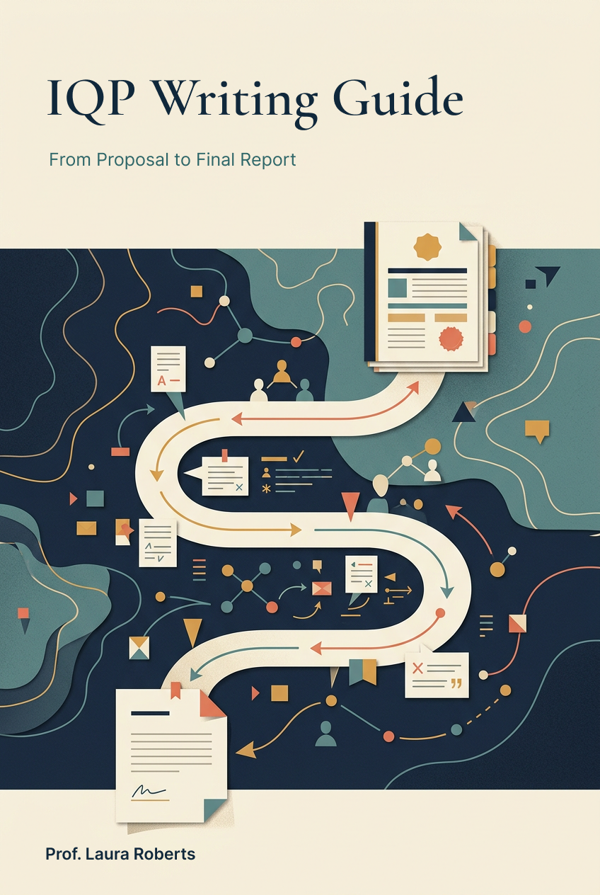

# IQP Writing Guide

*From Proposal to Final Report*

[View the cover full-size](assets/cover/iqp-writing-guide.png)

## Welcome

Welcome to the Interactive Qualifying Project (IQP) Writing Guide. This guide supports you as you write your ID2050 research proposal and IQP final report, from planning your research story to assembling and sharing your completed report.

## How to use this guide

Read the chapters in order or jump to the topic you need using the chapter links below. On the website, the **Chapters and sections** sidebar lets you explore each chapter's sections; on smaller screens, open the menu above the page. Use **Search the guide** in the header to find topics across the guide, and **Dark mode** to choose a comfortable reading theme.

Each chapter includes an **On this page** section list and previous/next links. Follow linked chapter and section references for related guidance. Planning tables stay in the guide, with links below them to download editable Word worksheets. Resources and Appendices A-D are collected on the Resources page.

## Contents

- [Chapter 1 - Writing Through the IQP Process](chapter-01.md)
- [Chapter 2 - Building Your Research Story](chapter-02.md)
- [Chapter 3 - Making Sense of and Communicating What You Learned](chapter-03.md)
- [Chapter 4 - Completing the Proposal and Final Report](chapter-04.md)
- [Chapter 5 - Documenting Your Project and Designing Your Report](chapter-05.md)
- [Chapter 6 - Sharing and Extending Your Project](chapter-06.md)
- [Resources](resources.md)

---

**Author’s Note and AI Disclosure:** *This guide draws on my experience teaching ID2050 and advising IQP projects since 2018, as well as writing guides, assignments, examples, and other instructional materials I have developed or adapted from materials generously shared by colleagues. In developing this guide, I used Microsoft CoPilot to help synthesize these materials, identify and address inconsistencies that had emerged over time, and improve the coherence, organization, and consistency of guidance across the ID2050 proposal and IQP process. While CoPilot was useful in the development of the guide, I am the author and take responsibility for its final content, including how the materials were selected, adapted, organized, and revised to reflect my teaching approach and the goals of ID2050 and the IQP.*
