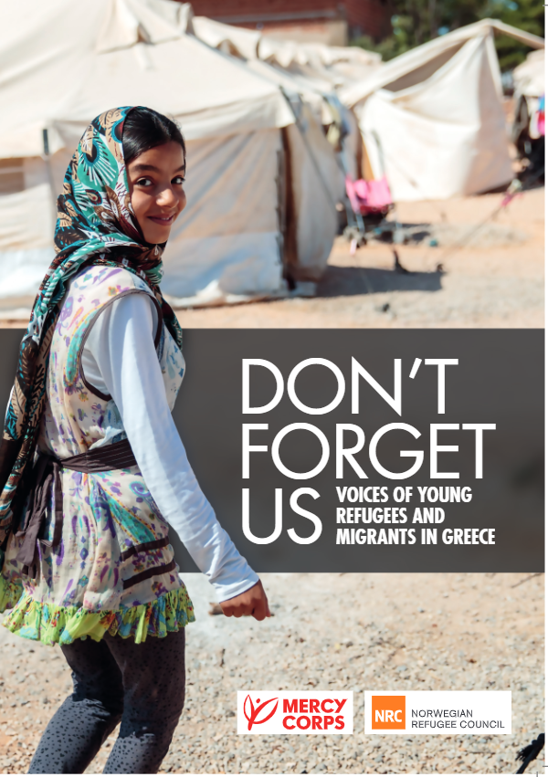
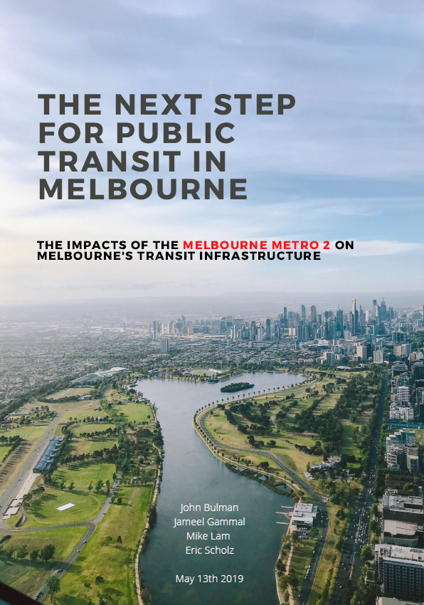
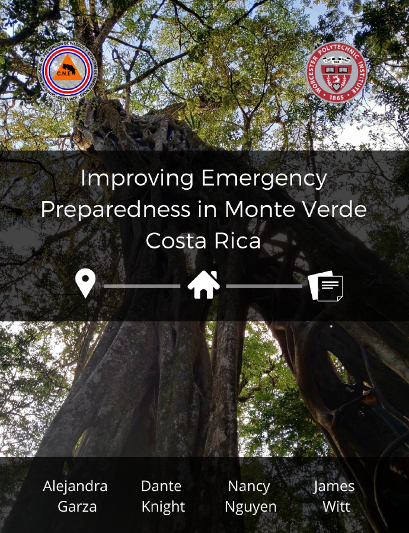
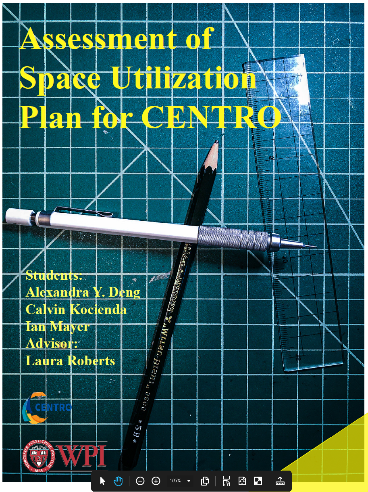
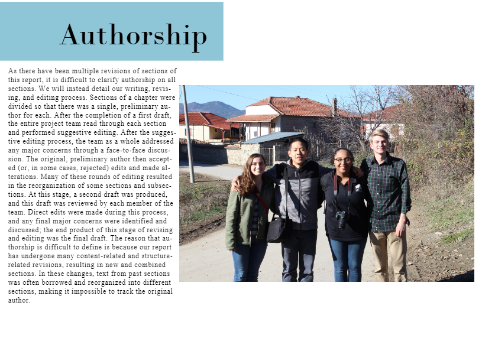
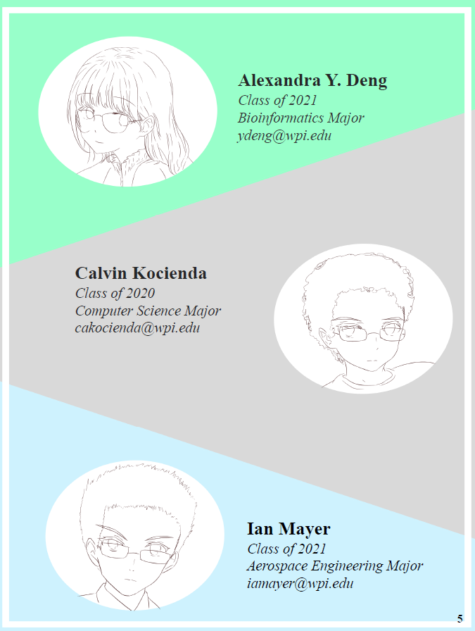
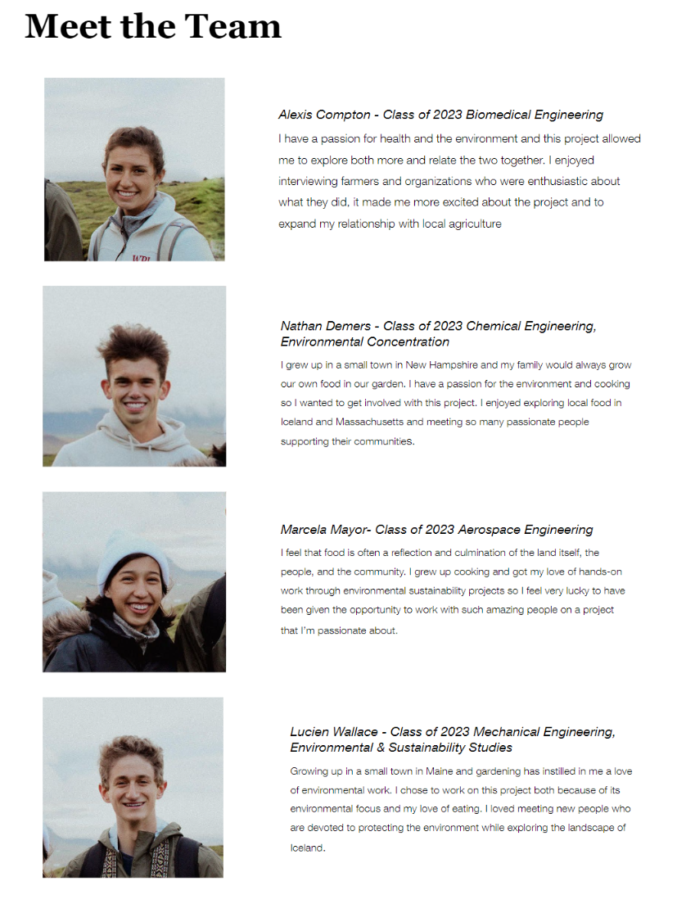

[Contents](index.html)

# Resources

**On this page**

- [Design Resources](#design-resources)
- [Examples of Exceptional Reports](#examples-of-exceptional-reports)
- [Examples of Exceptional Findings and Recommendations Chapters](#examples-of-exceptional-findings-and-recommendations-chapters)
- [APA and Citation Resources](#apa-and-citation-resources)
- [Appendix A: Cover Page Examples](#appendix-a-cover-page-examples)
- [Appendix B: Required WPI Title Page for Final Report](#appendix-b-required-wpi-title-page-for-final-report)
- [Appendix C: Example Final Report Authorship](#appendix-c-example-final-report-authorship)
- [Appendix D: Example Meet the Team Pages](#appendix-d-example-meet-the-team-pages)

## Design Resources

The following resources provide additional guidance for designing your final report:

<ul>
<li>
<a href="https://canvas.wpi.edu/courses/13957/modules"><u>WPI
Global Lab Design Guides</u></a> (you may need to join Canvas
Course)
</li>
<li>
<a
href="https://wpi0-my.sharepoint.com/personal/lroberts_wpi_edu/Documents/Terms/2021-22/A21%20-%20Iceland%20IQP/•%09https:/wpi0.sharepoint.com/sites/gr-global-lab-team/Shared%20Documents/Forms/AllItems.aspx?id=%2Fsites%2Fgr%2Dglobal%2Dlab%2Dteam%2FShared%20Documents%2FStoryworldsUnderConstruction%2FCanvas%2DTraining%2FFinal%2FGraphic%2Emp4&amp;parent=%2Fsites%2Fgr%2Dglobal%2Dlab%2Dteam%2FShared%20Documents%2FStoryworldsUnderConstruction%2FCanvas%2DTraining%2FFinal&amp;p=true&amp;originalPath=aHR0cHM6Ly93cGkwLnNoYXJlcG9pbnQuY29tLzp2Oi9zL2dyLWdsb2JhbC1sYWItdGVhbS9FVUN6cnAtT3RRbERvdGRhUVZESy0yb0I3aFQ2Z0FBN3dBX2JGcTVtS05QaVVBP3J0aW1lPUtOQ2tSLWthMlVn"><u>General
Design Overview</u></a>
</li>
<li>
<a
href="https://wpi0.sharepoint.com/sites/gr-global-lab-team/Shared%20Documents/Forms/AllItems.aspx?id=%2Fsites%2Fgr%2Dglobal%2Dlab%2Dteam%2FShared%20Documents%2FStoryworldsUnderConstruction%2FCanvas%2DTraining%2FFinal%2FCanva%2Emp4&amp;parent=%2Fsites%2Fgr%2Dglobal%2Dlab%2Dteam%2FShared%20Documents%2FStoryworldsUnderConstruction%2FCanvas%2DTraining%2FFinal&amp;p=true&amp;originalPath=aHR0cHM6Ly93cGkwLnNoYXJlcG9pbnQuY29tLzp2Oi9zL2dyLWdsb2JhbC1sYWItdGVhbS9FVGIyWFN6ZzVwMURqZmlvZExwMWlFWUJkeDk5RGlUZ0haaDFuY2JnMVd4YUpBP3J0aW1lPWJqMjhzQzhkMlVn"><u>Designing
in Canva</u></a>
</li>
<li>
<a
href="https://wpi0.sharepoint.com/sites/gr-global-lab-team/Shared%20Documents/Forms/AllItems.aspx?id=%2Fsites%2Fgr%2Dglobal%2Dlab%2Dteam%2FShared%20Documents%2FStoryworldsUnderConstruction%2FCanvas%2DTraining%2FFinal%2FCanva%2Emp4&amp;parent=%2Fsites%2Fgr%2Dglobal%2Dlab%2Dteam%2FShared%20Documents%2FStoryworldsUnderConstruction%2FCanvas%2DTraining%2FFinal&amp;p=true&amp;originalPath=aHR0cHM6Ly93cGkwLnNoYXJlcG9pbnQuY29tLzp2Oi9zL2dyLWdsb2JhbC1sYWItdGVhbS9FVGIyWFN6ZzVwMURqZmlvZExwMWlFWUJkeDk5RGlUZ0haaDFuY2JnMVd4YUpBP3J0aW1lPVoxdV9QT2thMlVn"><u>Designing
in Microsoft Word</u></a>
</li>
</ul>

## Examples of Exceptional Reports

The following reports provide examples of different approaches to visual design and communicating an IQP research story.

- **Community Support for Local Agriculture:** https://digital.wpi.edu/pdfviewer/7s75dg430

- **Melbourne Public Transit:** <https://digital.wpi.edu/pdfviewer/nv935517s>

- **Albania Public Place:** https://digital.wpi.edu/pdfviewer/3j333286f

- **Breaking Barriers, Changing Lives:** https://digital.wpi.edu/pdfviewer/2v23vw91j

- **Sense of Place, Tirana:** https://digital.wpi.edu/pdfviewer/q524jp04t

- **The Women's Perspective:** https://digital.wpi.edu/pdfviewer/9k41zf155

## Examples of Exceptional Findings and Recommendations Chapters

The following examples from previous IQPs illustrate different approaches to presenting Findings, analysis, and Recommendations.

- **Albanian Brewery Waste:** <https://digital.wpi.edu/pdfviewer/z890rw777>

- **Monte Verde Emergency Preparedness:** <https://digital.wpi.edu/pdfviewer/6969z3293>

- **Northborough Composting:** <https://digital.wpi.edu/pdfviewer/0r967424w>

- **Nantucket Parking:** <https://digital.wpi.edu/pdfviewer/bk128b35f>

## APA and Citation Resources

- **WPI Library APA Citation Guide:** <https://libguides.wpi.edu/citingsources/apa>

- **Purdue OWL APA Style Guide:** <https://owl.purdue.edu/owl/research_and_citation/apa_style/apa_style_introduction.htm>

## Appendix A: Cover Page Examples

## Appendix B: Required WPI Title Page for Final Report

***Project Title***

An Interactive Qualifying Project submitted to the Faculty of

WORCESTER POLYTECHNIC INSTITUTE

in partial fulfilment of the requirements for the degree of Bachelor of Science/Arts.

by

Author Name A

Author Name B

Author Name C

Date:

Day Month Year

Report Submitted to:

Sponsor Liaison(s)

Sponsoring Organization

Professors Name A and Name B

Worcester Polytechnic Institute

<em>This report represents work of WPI undergraduate students
submitted to the faculty as evidence of a degree requirement. WPI
routinely publishes these reports on its web site without editorial or
peer review. For more information about the projects program at WPI, see
<a
href="http://www.wpi.edu/Academics/Projects"><u>http://www.wpi.edu/Academics/Projects</u></a>.</em>

## Appendix C: Example Final Report Authorship

Please note: Your Proposal should use an [Authorship Table](chapter-04.html#authorship-table) as described in [section 4.2](chapter-04.html#completing-your-id2050-research-proposal).

## Appendix D: Example Meet the Team Pages

---

[Contents](index.html) | [Previous: Chapter 6 - Sharing and Extending Your Project](chapter-06.html)
